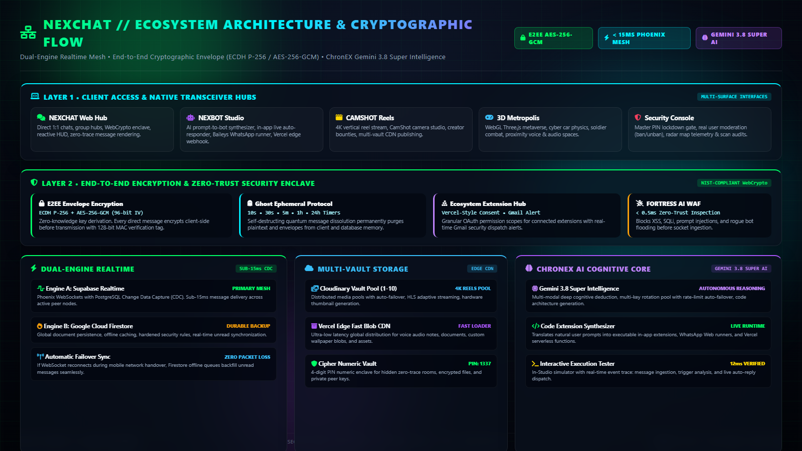
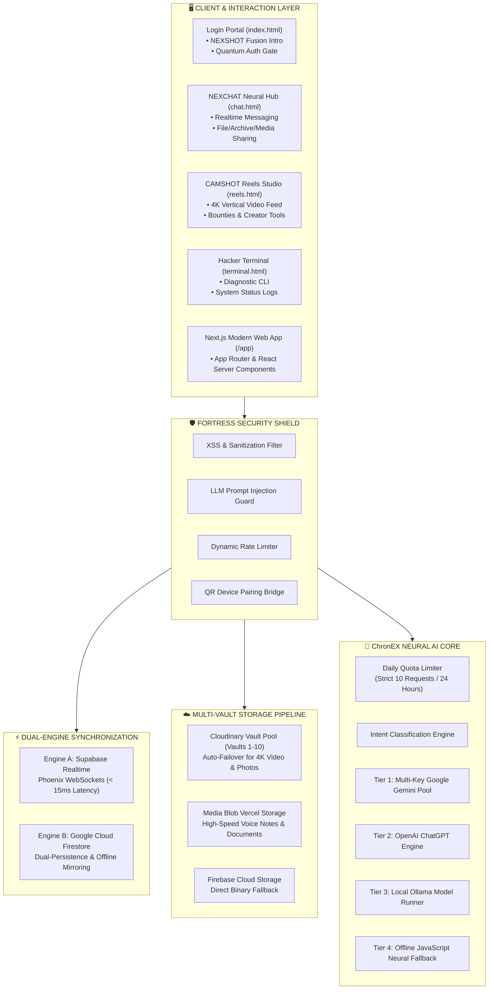
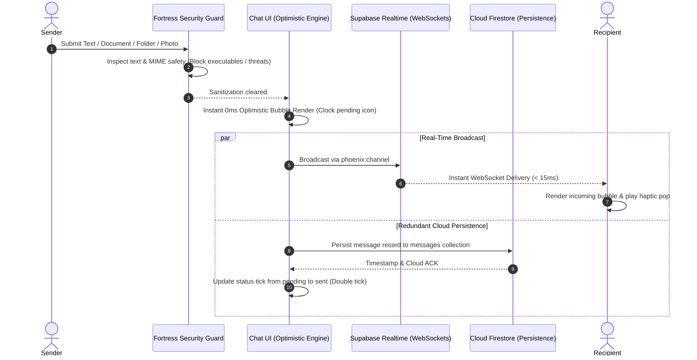
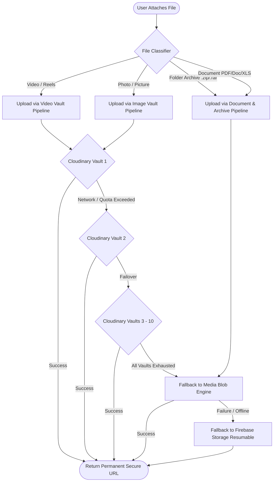
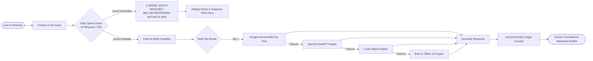

# ⚡ NEXSHOT // The Unified Next-Gen Cyber Ecosystem

[](https://github.com/alexhack235-code/NEXCHAT)
[](https://github.com/alexhack235-code/NEXCHAT)
[](https://github.com/alexhack235-code/NEXCHAT)
[](https://github.com/alexhack235-code/NEXCHAT)

> **`[ THE FUTURE IS RIGHT HERE ]`**  
> **NEXSHOT** represents the state-of-the-art technological convergence of **NEXCHAT** (Quantum-Encrypted Neural Messaging & Dual-Engine Real-Time Chat) and **CAMSHOT** (Pro Cinematic Reels, Multi-Vault Decentralized Storage & Studio Camera Tools).

<p align="center">
  
</p>

---

## 🌟 The Convergence Formula

```text
 ┌───────────────────────────────────┐       ┌───────────────────────────────────┐
 │              NEXCHAT              │       │              CAMSHOT              │
 │  • Real-Time Neural Messaging     │   ✕   │  • 4K Studio Reels & Camera Tools │
 │  • Dual-Engine Realtime Sync      │       │  • Multi-Vault Cloud Storage Pool │
 │  • High-Speed Voice & Call Hub    │       │  • Interactive Creator Ecosystem  │
 └───────────────────────────────────┘       └───────────────────────────────────┘
                                   │           │
                                   ▼           ▼
                     ═════════════════════════════════════
                                   NEXSHOT
                     ═════════════════════════════════════
                     "THE FUTURE IS RIGHT HERE"
```

---

## 🏛️ Ecosystem Architecture Diagrams

### 1. High-Level System Architecture



---

### 2. Dual-Engine Real-Time Messaging Lifecycle



---

### 3. Multi-Vault Media Storage & Failover Architecture



---

### 4. ChronEX AI Intelligence Pipeline & Daily Rate Limiter



---

## 📁 Repository Directory Structure

```text
NEXCHAT/
├── index.html                   # Cyber Login Gate & NEXSHOT Fusion Cinematic Intro Overlay
├── login.css                    # Futuristic styling for login, streams, and fusion keyframes
├── auth.js                      # Authentication controller, Web Audio synthesizer & intro engine
├── chat.html                    # NEXCHAT core communication portal
├── chat.css                     # Comprehensive design system, cyberpunk chat styling & animations
├── chat.js                      # Chat engine: presence, attachments, typing, voice notes & DB sync
├── reels.html                   # CAMSHOT Studio: Vertical 4K creator reels & video playback
├── reels.css                    # Reels layout, responsive video swiper, bounties & creator drawer
├── reels.js                     # Reels player, feed ingestion, like/comment algorithms & sound hub
├── terminal.html                # Cyberpunk hacker terminal for diagnostics & real-time telemetry
├── landing.html                 # Product showcase, feature tours & interactive demonstrations
├── chronex-ai-service.js        # ChronEX AI Brain: Multi-tier LLM router & 10 req/day quota engine
├── messaging-features.js        # Auxiliary chat utilities: voice waveforms, reply previews, polls
├── firebase-config.js           # Firebase Client Initialization (Auth, Firestore, RTDB, Storage)
├── supabase-schema.sql          # PostgreSQL schema & Realtime publication setup for Supabase
│
├── src/
│   └── js/
│       ├── security-shield.js   # FORTRESS Security Guard (XSS, Injection & Sanitization)
│       ├── security-guard.js    # Device trust evaluation & anti-tamper safeguards
│       ├── cloudinary.js        # Multi-Vault Cloudinary Media Storage Pipeline (Vaults 1-10)
│       ├── media-upload.js      # Universal media upload orchestrator & blob wrappers
│       ├── reels-vault.js       # Dedicated storage management for CAMSHOT reels videos
│       ├── status-vault.js      # Ephemeral 24h status media storage management
│       ├── reels-sounds.js      # Soundtrack library & audio mixer for CAMSHOT reels
│       ├── supabase-chat.js     # Supabase Realtime broadcast client & message subscriber
│       ├── supabase-config.js   # Dynamic Supabase WebSocket configuration & connection tester
│       ├── presence.js          # Peer presence & real-time typing indicators
│       ├── livekit-call.js      # WebRTC voice/video calling integration via LiveKit
│       ├── link-device.js       # Multi-device synchronization via encrypted QR handshakes
│       └── wallpaper-presets.js # Dynamic cyberpunk wallpaper engine
│
├── app/                         # Next.js App Router (Full-Stack Modern Extension)
│   ├── layout.tsx               # Root Next.js layout & global theme hydration
│   ├── globals.css              # Universal design tokens and utility classes
│   ├── profile/page.tsx         # User profile manager, badges, token ledger
│   ├── reels/page.tsx           # Modern React-based reels stream
│   ├── status/page.tsx          # Status stories view
│   ├── upload/page.tsx          # Cloud video & poster upload workflow
│   └── api/
│       └── reels/route.ts       # Serverless REST endpoints for reels feed management
│
├── api/                         # Vercel Serverless Functions
│   ├── _security.js             # API request validation & signature checking
│   ├── ai.js                    # Server-side AI proxy
│   ├── reels.js                 # Reels ingestion handler
│   ├── upload.js                # Secure server-side media upload endpoint
│   └── serve-blob.js            # Media streaming proxy
│
└── components/                  # Reusable React & Web Components
    └── NEXLogo.tsx              # Dynamic Vector Brand Emblem
```

---

## ⚡ Core Feature Modules

### 1. 💬 NEXCHAT Neural Messaging
* **Dual-Engine Realtime Synchronization:** Combines the sub-15ms WebSocket speed of Supabase with the resilient offline-first persistence of Google Cloud Firestore.
* **Universal File & Document Sharing:** Native pipeline supporting pictures (`.jpg`, `.png`, `.webp`), compressed folder archives (`.zip`, `.rar`, `.tar`, `.7z`), documents (`.pdf`, `.docx`, `.xlsx`, `.txt`), and voice notes up to 50MB.
* **Interactive Media Cards:** High-definition photo viewers, gold-badged folder archive download containers, and document preview chips.
* **Multi-Device Link Pairing:** Instant QR-code device linking with cryptographic token handshakes.

### 2. 🔒 End-to-End Cryptographic Envelope & Inspector (E2EE)
* **Hardware-Accelerated WebCrypto:** Pure client-side cryptography via the browser's native `crypto.subtle` API.
* **Asymmetric Key Exchange:** **ECDH (Elliptic Curve Diffie-Hellman)** on the **NIST P-256 curve** for zero-knowledge peer key derivation.
* **Symmetric Cipher:** **AES-256-GCM** with fresh, cryptographically secure 96-bit random Initialization Vectors (IVs) per message.
* **Tamper-Proof Integrity:** 128-bit Authentication Tags (GCM MAC) to detect any payload tampering.
* **Interactive Envelope Inspector:** Click the `🔒 E2EE` badge on any message to open the live inspector modal displaying raw ciphertext (Hex/Base64), IVs, curve parameters, and verification tags.

### 3. 🤖 NEXBOT Studio // AI Bot Creator & Code Extension Suite
* **Natural Prompt-to-Bot Synthesizer:** Type natural directives (e.g. *"Create a bot for no reply when away or busy"*) to automatically synthesize persona archetypes, system brain instructions, wildcard triggers, and simulated latency.
* **Dedicated Code Extension & Runner Tab (`bot-tab-extension`):** Multi-target code generation offering:
  * **In-App Client Extension:** Executable JavaScript hook that runs directly inside NEXCHAT to intercept incoming peer messages and auto-respond.
  * **Node.js / Baileys WhatsApp Runner:** Standalone WhatsApp Web bot script with QR terminal authentication.
  * **Vercel Serverless Function:** Ready-to-deploy edge webhook (`api/whatsapp-webhook.js`).
  * **Chrome Web Extension:** Manifest V3 content script for web messenger automation.
* **Interactive Live Execution Simulator:** Test runner with real-time event trace: message ingestion, trigger analysis, and live auto-reply dispatch.
* **One-Click Ecosystem Hub Registration:** Persists custom bots directly into the Vercel-Style Extension Consent Hub.

### 4. 🧩 Vercel-Style Ecosystem Extension Consent Hub
* **Zero-Trust OAuth Permission Management:** Interactive modal displaying granular permission scopes (`read:profile`, `write:media_vault`, `sync:chat_feed`, `security:telemetry`).
* **Automated Gmail Security Alerts:** Real-time email dispatch alerting the account owner whenever an extension permission is approved or revoked.
* **Dynamic Extension Discovery:** Browse, authorize, or revoke ecosystem applications like NEX-REELS, NEX-METROPOLIS 3D, and custom NEXBOT agents.

### 5. 🛡️ SuperAdmin Security Command Center
* **Zero-Trust Master PIN Gate:** Protected by numeric master access PIN (`1337`) preventing unauthenticated access.
* **Live User Moderation:** Real-time user ledger with instant account banning/unbanning, muting, and privilege revocation.
* **Interactive Radar & Threat Telemetry:** Canvas radar map displaying active nodes, signal strengths, IP footprints, and WAF security scanner logs.

### 6. 🧼 Settings Suite Sanitization & Security Hardening
* **Zero Credential Leakage:** All raw backend Supabase Anon Keys, project URLs, and WAF vault keys have been completely purged from client inputs and settings DOM.
* **Clean User Dashboard:** Replaced with live connection status (`Connected & Synchronized`), real-time latency ping testing, and privacy toggles.
* **Purged Admin Triggers:** Administrative consoles are strictly unlinked from regular user menus.

### 7. 👻 Ghost Ephemeral Countdown Protocol
* **Quantum Self-Destruct Timers:** Ephemeral message countdowns (10s, 30s, 5m, 1h, 24h).
* **Permanent Data Scrubbing:** Automatically scrubs plaintext and cryptographic envelopes from both client storage and Firestore databases upon expiration.

### 8. 🎬 CAMSHOT 4K Creator Reels
* **Next-Gen Reels Experience:** Smooth vertical feed navigation with hardware-accelerated transitions.
* **Multi-Vault Cloud Pipeline:** Zero-backend upload architecture sequentially rotating across multiple storage vaults for 99.99% availability.
* **Creator Bounty & Monetization Hub:** Token reward mechanics for creator engagement and viral trends.
* **Soundtrack Studio:** Integrated audio mixing with custom sound overlays.

### 9. 🎮 GamingHub & 3D WebGL Metropolis Cyberverse
* **Three.js Cyberverse:** 3D soldier combat, cyber vehicles, real-time physics engine, and proximity audio spaces.
* **GamingHub Portal:** Multi-game launcher connecting instant browser games and WebGL metaverse experiences.

### 10. ✨ NEXSHOT Fusion Cinematic Intro
* **Visual Convergence:** Cinematic intro overlay on the login portal where **NEXCHAT** (Cyan/Emerald stream) and **CAMSHOT** (Gold/Iris stream) collide at a central singularity to manifest **NEXSHOT**.
* **Tagline:** `[ THE FUTURE IS RIGHT HERE ]`
* **Zero-Asset Web Audio Synthesizer:** Pure mathematical frequency synthesis producing ambient start chimes, sub-bass collision impacts, and harmonic quantum chords.
* **User Control:** One-click Skip Intro button, audio mute toggle, session memory, and an on-demand Replay trigger.

### 11. 🧠 ChronEX AI Brain & Gemini Super Intelligence
* **10 Requests/Day Rate Limit:** Rolling 24-hour window quota enforcement. If a user exceeds the daily threshold, the model gracefully informs:
  > `MODEL QUOTA REACHED ! WILL BE REFRESHED WITHIN 24 HRS`
* **Multi-Tier Model Routing:** Sequential automatic failover across Google Gemini (Tier 1 Key Pool), OpenAI ChatGPT, Local Ollama, and offline rule-based neural modules.
* **Super Intelligence Cognitive Engine:** Upgraded system instructions for quantum software architecture, algorithm deductions, and code synthesis.

### 12. 🛡️ FORTRESS Security Shield
* **Pre-Flight Sanitization:** Scans all outbound chat messages and incoming directives against XSS payloads and malicious code injection.
* **LLM Guard:** Blocks jailbreaks and prompt injection attempts before queries reach the AI brain.
* **Anti-Executable Filter:** Automatically rejects dangerous executable binaries (`.exe`, `.bat`, `.cmd`, `.sh`, `.msi`) from attachment queues.

### 13. 🎙️ NEX-VOICE // Quantum Waveform Voice Note Studio & ChronEX Transcriber
* **Hardware-Accelerated Voice Capture:** Web Audio API `AudioContext` and `MediaRecorder` pipeline (WebM/Opus, Ogg, WAV fallback).
* **Live Neon Waveform Visualizer:** 10 dynamic bars reacting to live microphone frequency amplitudes (`AnalyserNode.getByteFrequencyData`).
* **Live Recording HUD:** Pulsing red beacon, live stopwatch timer (`MM:SS`), Cancel, Stop, and Send buttons.
* **ChronEX AI Speech-to-Text Transcriber:** In-chat audio player sub-bar with an interactive `🤖 ChronEX Transcribe` button and playback speed toggles (`1x`, `1.5x`, `2x`).

### 14. 🕵️ NEX-STEGANO // Quantum Pixel Steganography Enclave
* **Lossless LSB Steganography:** Encodes encrypted secret text messages directly into the Least Significant Bits of pixel color channels (R, G, B) of any image.
* **Zero-Knowledge Passcode Encryption:** Optional XOR/PIN cipher keyed to the user's secret passphrase before bit packing.
* **In-Chat Auto-Detection:** Automatically scans incoming images for the `NEXSTEG01` signature and displays a glowing `🕵️ Stegano Enclave [Decrypt]` badge.

### 15. 🎨 NEX-CANVAS // Tactical Whiteboard & Neon Laser Doodle
* **Tactical Cyber Drawing Studio:** High-DPI canvas whiteboard accessible directly from the attachment hub or header.
* **Neon Brush Palette:** Laser Cyan (`#00f3ff`), Matrix Emerald (`#00ff66`), Solar Gold (`#ffd700`), Cyber Violet (`#c026d3`), Crimson Glitch (`#ff0055`), and Ghost White (`#ffffff`).
* **Laser Bloom Glow:** Real-time canvas bloom via `shadowBlur = 14` and `shadowColor`.
* **Direct Encrypted Dispatch:** Instantly renders canvas vectors to a PNG attachment and broadcasts into active conversations.

### 16. 🛡️ Ghost Panic Lock & Matrix Decoy Terminal (`Ctrl+Shift+L` / Panic Shield)
* **Instant Privacy Cloak:** Triggered via hotkey (`Ctrl+Shift+L` or `Alt+G`) or header shield button (`#ghostPanicLockBtn`).
* **60 FPS Matrix Digital Rain:** Fullscreen animated canvas rain rendering green katakana and hexadecimal glyphs.
* **Master PIN Disarm:** Numeric PIN gate (`1337`) to disarm the shield and restore workspace.
* **Decoy Mode Toggle:** One-click switch to a decoy server trace terminal (`KERNEL_DAEMON_TRACE [PID 4092]`), hiding chat activity from casual observers.

### 17. ⚡ NEX-SANDBOX // Interactive In-Chat Code & Extension Runner
* **In-Chat Run Buttons:** Every code block generated by ChronEX AI or shared in chat includes an interactive `▶️ Run in Sandbox` button.
* **Dual-Pane Execution Modal:** Monaco-style code editor alongside an isolated `<iframe>` execution environment with `sandbox="allow-scripts allow-modals"`.
* **Real-Time Console Stream:** Intercepts `console.log`, `console.warn`, and `console.error` and streams formatted output to an in-app terminal log.

---

## ⚙️ Environment Configuration

Copy `.env.example` to `.env` and populate with your own project credentials:

```bash
cp .env.example .env
```

### Sanitized `.env.example` Specification

```ini
# ChronEX AI Configuration
AI_PROVIDER=gemini
GEMINI_API_KEY_1=<your_primary_gemini_api_key>
GEMINI_API_KEY_2=<your_secondary_gemini_api_key>
OPENAI_API_KEY=<your_openai_api_key_optional>
AI_TEMPERATURE=0.7
AI_MAX_TOKENS=2048

# Multi-Vault Storage (Cloudinary Unsigned Credentials)
CLOUDINARY_CLOUD_NAME=<your_cloudinary_cloud_name>
CLOUDINARY_UPLOAD_PRESET=<your_unsigned_upload_preset>

# Vercel Blob Storage Tokens (Optional Fallback)
BLOB_READ_WRITE_TOKEN=<your_vercel_blob_token>
BLOB_READ_WRITE_TOKEN_MEDIA=<your_media_blob_token>

# Application Config
PORT=3000
DEBUG=false
```

> 🔒 **Security Notice:** Never commit `.env` or personal credentials to public source control. Keep `.gitignore` updated.

---

## 🚀 Getting Started

### Option A: Static Web Application (Zero-Build)
NEXCHAT is designed to run directly on any static web server without build steps:

```bash
# Using Python
python -m http.server 3000

# Using Node.js live-server
npx serve -l 3000
```
Navigate to `http://localhost:3000/index.html` to experience the login gate and the **NEXSHOT** fusion animation.

### Option B: Modern Next.js Full-Stack App
```bash
# Install dependencies
npm install

# Start Next.js development server
npm run dev
```
Navigate to `http://localhost:3000` to interact with the App Router interface.

---

## 📄 License & Attribution

* **Architected & Engineered by:** **NEXO-TECH** & **NEXCHAT Dev Teams**
* **Branding:** NEXCHAT, CAMSHOT, and NEXSHOT are proprietary original marks of the project.
* **License:** [MIT License](LICENSE) (or Private Workspace License)
