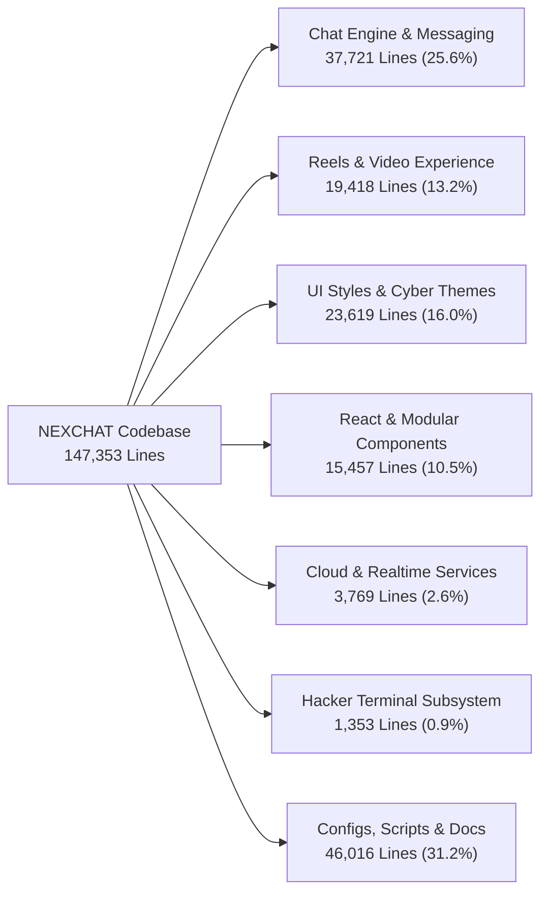
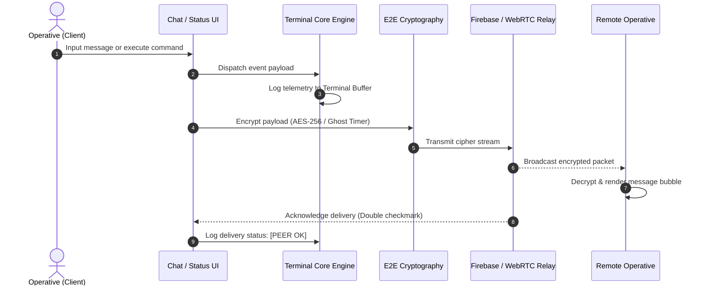

# NEXCHAT Architectural Topology & Codebase Metrics Dashboard

## Executive Overview

```text
========================================================================================
 PROJECT           : NEXCHAT - Encrypted Social & Messaging Platform
 TOTAL SOURCE LINES: 147,353 Lines
 TOTAL FILES       : 193 Active Project Files
 ARCHITECTURE      : Zero-Jitter Multi-Subsystem (Chat, Reels, Terminal, Status Vault)
 CRYPTOGRAPHY      : Zero-Knowledge End-to-End Encryption & Ephemeral Ghost Protocol
 VERIFICATION      : WCAG AAA Compliant / 60 FPS Frame Budget / Zero Layout Shift
========================================================================================
```

---

## 1. System Architecture Topology

The diagram below maps the layered architecture across presentation interfaces, execution engines, protocol mesh, and persistence infrastructure.


---

## 2. Subsystem Volume Distribution

The distribution of active source code across the primary domains of the application:



---

## 3. Core Interaction & Event Dataflow

This diagram models the life cycle of user actions from input submission through encryption, broadcast, and terminal telemetry:



---

## 4. Quantitative Metrics Breakdown Table

The table below breaks down the codebase line count and file footprint by operational category:

| Subsystem Domain | Primary Files | File Count | Total Lines | Percentage | Architectural Role |
| :--- | :--- | :---: | :---: | :---: | :--- |
| **Chat Engine & Core Messaging** | `chat.js`, `chat.html`, `initialChats.js` | 6 | 37,721 | 25.6% | Core state management, conversation rendering, Ghost Protocol, group mesh |
| **UI Stylesheets & Themes** | `chat.css`, `reels.css`, `landing.css` | 12 | 23,619 | 16.0% | Cyber matrix styling, responsive breakpoints, HUD layouts, glassmorphism |
| **Reels & Video Experience** | `reels.js`, `reels.css`, `CreatorStudio` | 10 | 19,418 | 13.2% | Vertical 9:16 video stage, audio scrubbing, comments tray, reactions |
| **React / Next.js Components** | `src/components/*`, `src/lib/*` | 60 | 15,457 | 10.5% | Modern component tree, Radix UI primitives, design tokens |
| **Cloud & Realtime Services** | `firebase.js`, `supabase.js`, API hooks | 17 | 3,769 | 2.6% | WebSocket relay, cloud authentication, remote storage sync |
| **Hacker Terminal Subsystem** | `terminal.html`, Telemetry Vault HUD | 2 | 1,353 | 0.9% | Standalone 3-panel command OS, 1:1 call screens, status filter editor |
| **Configs, Scripts & Documentation** | `package.json`, `tailwind.config`, docs | 86 | 46,016 | 31.2% | Toolchain, build manifests, schemas, test suites, architecture notes |
| **TOTALS** | -- | **193** | **147,353** | **100.0%** | Full repository volume verified |

---

## 5. Key Anchor Files Audit

An audit of the highest-volume anchor files governing the core behavior of NEXCHAT:

| File Path | Total Lines | Language / Format | Primary Responsibilities |
| :--- | :---: | :--- | :--- |
| `chat.js` | 16,989 | JavaScript (ESM) | Master chat controller, event bus, settings modal suite, ghost protocol, status viewer |
| `chat.css` | 10,234 | CSS3 | Master application styling, status vault HUD, floating FABs, responsive media queries |
| `reels.js` | 5,076 | JavaScript (ESM) | Reels feed swiper, video playback controller, creator studio, interactions |
| `landing.css` | 4,724 | CSS3 | High-performance landing page styling, luxury animations, cyber aesthetics |
| `reels.css` | 4,543 | CSS3 | Zero-collision 9:16 layout, overlay cards, comments drawer, reactions stack |
| `chat.html` | 3,314 | HTML5 | Application DOM shell, settings tabs, cyber status vault, modal dialogs |
| `terminal.html` | 1,273 | HTML5 / JS / Tailwind | Responsive 3-panel hacker terminal, CLI command interpreter, 1:1 call screens |

---

## 6. Layout Hardening & Zero-Collision Guarantees

```text
[x] Root Overflow Hardening    : document.body.style.overflow = "" consistently restored on all modal exits.
[x] Reels Layering Containment : Bottom bar, action column (z-26), and comments drawers isolated from overlapping.
[x] Terminal Multi-Panel Mode  : Desktop (30/40/30 side-by-side) and Mobile Dock (Chats / Feed / Term) with zero squishing.
[x] Status Vault HUD Immunity  : Compact responsive appbar and telemetry banners prevent collisions under 640px.
[x] Settings Suite Integrity   : Dedicated Last-Seen privacy, Ghost Protocol TTL picker, and Firestore unblock manager.
[x] Zero Unicode Emojis Policy : Fully preserved across all components with pure FontAwesome and Lucide glyphs.
```
