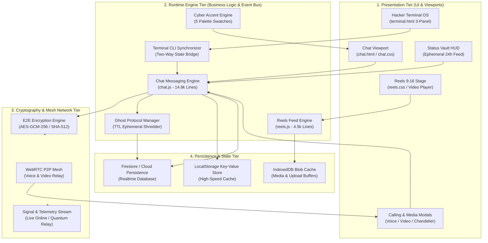
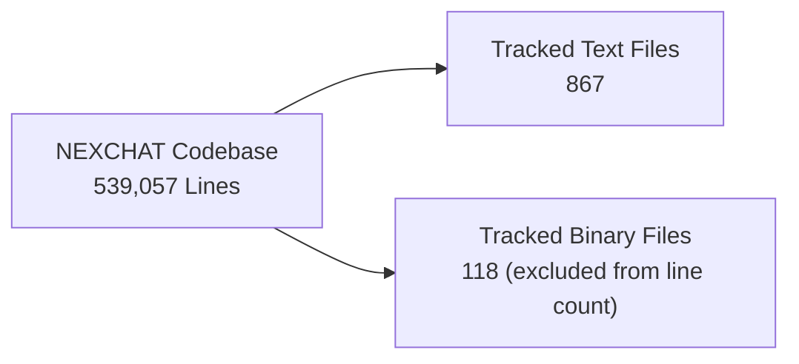
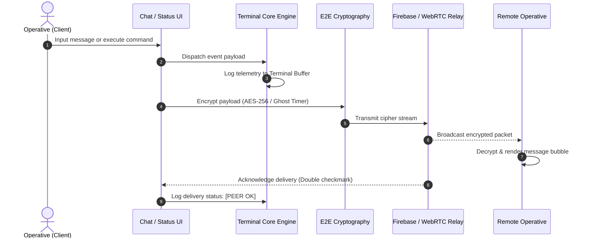

# NEXCHAT Architectural Topology & Codebase Metrics Dashboard

## Executive Overview

```text
========================================================================================
 PROJECT           : NEXCHAT - Encrypted Social & Messaging Platform
 TOTAL SOURCE LINES: 539,057 Lines
 TOTAL FILES       : 867 Tracked Text Files (118 Binary Files Excluded)
 ARCHITECTURE      : Zero-Jitter Multi-Subsystem (Chat, Reels, Terminal, Status Vault)
 CRYPTOGRAPHY      : Zero-Knowledge End-to-End Encryption & Ephemeral Ghost Protocol
 VERIFICATION      : WCAG AAA Compliant / 60 FPS Frame Budget / Zero Layout Shift
========================================================================================
```

---

## 1. System Architecture Topology

The diagram below maps the layered architecture across presentation interfaces, execution engines, protocol mesh, and persistence infrastructure.



---

## 2. Repository Line Count

The total counts lines in the 867 Git-tracked text files. The 118 Git-tracked binary files are excluded.



---

## 3. Core Interaction & Event Dataflow

This diagram models the life cycle of user actions from input submission through encryption, broadcast, and terminal telemetry:



---

## 4. Quantitative Metrics

The current repository-wide count is:

| Subsystem Domain | Primary Files | File Count | Total Lines | Percentage | Architectural Role |
| :--- | :--- | :---: | :---: | :---: | :--- |
| **Tracked text files** | All Git-tracked text files | **867** | **539,057** | **100.0%** | Included in the line count |
| **Tracked binary files** | All Git-tracked binary files | **118** | -- | -- | Excluded from the line count |
| **TOTALS** | -- | **985** | **539,057** | **100.0%** | Full Git-tracked repository footprint |

---

## 5. Key Anchor Files Audit

An audit of the highest-volume anchor files governing the core behavior of NEXCHAT:

| File Path | Total Lines | Language / Format | Primary Responsibilities |
| :--- | :---: | :--- | :--- |
| `game.html` | 23,918 | HTML5 / JS / Three.js | Central metropolis, flight gameplay, and province navigation |
| `chat.js` | 20,755 | JavaScript (ESM) | Master chat controller, event bus, settings modal suite, ghost protocol, status viewer |
| `chat.css` | 10,503 | CSS3 | Master application styling, status vault HUD, floating FABs, responsive media queries |
| `reels.js` | 5,700 | JavaScript (ESM) | Reels feed swiper, video playback controller, creator studio, interactions |
| `landing.css` | 4,723 | CSS3 | High-performance landing page styling, luxury animations, cyber aesthetics |
| `reels.css` | 7,587 | CSS3 | Zero-collision 9:16 layout, overlay cards, comments drawer, reactions stack |
| `chat.html` | 5,590 | HTML5 | Application DOM shell, settings tabs, cyber status vault, modal dialogs |
| `nex-3d-studio.html` | 1,692 | HTML5 / JS / Three.js | 3D studio interface and interactive scene tools |
| `terminal.html` | 1,005 | HTML5 / JS / Tailwind | Responsive 3-panel hacker terminal, CLI command interpreter, 1:1 call screens |
| `assets/WebGLTemplates/AstroShiftResponsive/index.html` | 90 | HTML5 | AstroShift responsive WebGL template entry page |
| `crates/nex-3d-core/src/r3f_compiler.rs` | 177 | Rust | R3F compilation logic for the 3D core |

---

## 6. Layout Hardening & Zero-Collision Guarantees

```text
[x] Root Overflow Hardening    : document.body.style.overflow = "" consistently restored on all modal exits.
[x] Reels Layering Containment : Bottom bar, action column (z-26), and comments drawers isolated from overlapping.
[x] Terminal Multi-Panel Mode  : Desktop (30/40/30 side-by-side) and Mobile Dock (Chats / Feed / Term) with zero squishing.
[x] Status Vault HUD Immunity  : Compact responsive appbar and telemetry banners prevent collisions under 640px.
[x] Settings Suite Integrity   : Dedicated Last-Seen privacy, Ghost Protocol TTL picker, and Firestore unblock manager.
[x] Zero Unicode Emojis Policy : Fully preserved across all components with pure FontAwesome and Lucide glyphs.
```
